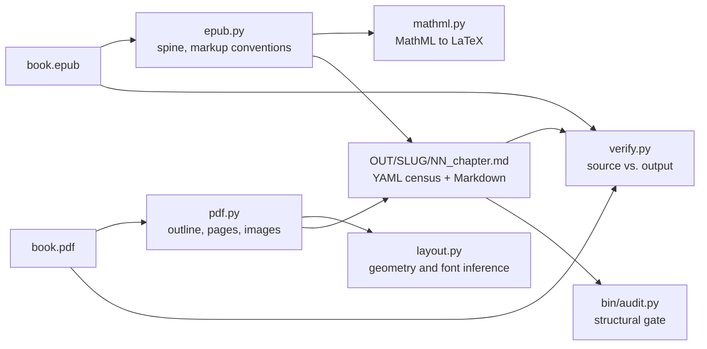

# Architecture

Two converters with one output shape, and a verifier that reads both ends.

`cli.py` is the single entry point (`h2m epub|pdf|verify`). It splits argv and hands the rest to the chosen module's `main`, because the two pipelines share no options ([N4](DECISIONS.md)). It also turns unreadable input into exit code 1 with a one-line message.

## What each module owns

| Module | Owns | Key names |
|---|---|---|
| `epub.py` | Reading the OPF (metadata, spine) and NCX; rendering each spine document to Markdown; the publisher conventions (MathML in comments, code as nested divs, InDesign paragraph classes, tables wrapped in `<figure>`, page-break spans); dropping navigation documents; regrouping a flat spine into chapters from the contents page; the front-matter census; optional figure extraction. | `Epub`, `Renderer`, `convert_doc`, `toc_chapter_starts`, `main` |
| `mathml.py` | MathML to LaTeX with stdlib ElementTree only: fractions, roots, scripts, piecewise `cases`, accents, primes, the Mathematical Italic plane. Unknown elements keep their text. | `mathml_to_latex`, `conv` |
| `pdf.py` | Splitting a PDF into chapters from its outline (choosing the outline depth that gives chapter-sized units); turning each page into typed blocks (heading, paragraph, table, code, image, folio); dropping ink-free images; the ligature pass with code fences parked; front matter; figure extraction. | `Doc`, `render`, `has_ink`, `main` |
| `layout.py` | Everything inferred from geometry: the per-document `Profile` (body size, leading, text column, running-head heights, folio heights), landscape pages, running-head and folio removal, drop caps, hyphenation healing, table detection, ligature repair against one named word list. | `Profile`, `page_lines`, `unrotate_landscape`, `as_table`, `join_text`, `fix_ligatures` |
| `verify.py` | Extracting plain text from the source (restricted to what the output's own `source_file:` / `pdf_pages:` fields say was converted), normalising both sides to letters and digits, the windowed comparison, and the report. | `normalise`, `compare`, `kept_source_text`, `main` |
| `bin/audit.py` | A development tool, not installed: checks a directory of converted books for structural faults a reader would hit. | `main` |

## The data in between

- **EPUB**: each spine document is parsed with BeautifulSoup after MathML has been cut out and converted (bs4 mangles the namespace). The renderer emits a list of `(kind, text)` blocks, with page markers, block equations, images and captions held as `\x01`-delimited placeholders until the end, so that whitespace cleanup cannot damage them. Code fences are parked behind placeholders during that cleanup, because indentation is meaning ([N17](DECISIONS.md)).
- **PDF**: `layout.raw_lines` reads PyMuPDF's span dictionary into `Line` objects. `Profile` measures the document once; every threshold is relative to it rather than a constant ([N8](DECISIONS.md)). `page_lines` removes furniture and harvests the folio; `Doc.page_blocks` classifies what is left.
- **Output**: one file per chapter, `NN_slug.md`, zero-padded so that plain sorting is reading order. The YAML front matter records provenance and a census (words, equations, tables, figures, code) so a missing category is visible without opening the file ([N2](DECISIONS.md)).
- **Verification** never trusts the converter's own counts: it re-reads the source.

## Where the tests sit

Every test builds its own EPUB or PDF in `tests/conftest.py`, in the shape a real publisher emits, and runs the real pipeline on it. `test_cli.py` runs `h2m` as a subprocess and checks exit codes; `test_examples.py` checks that `examples/` is still exactly what the code produces; `test_audit.py` covers `bin/audit.py`.
